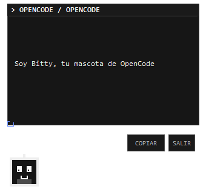

# Bitty Mascot

> Mascota flotante, pixelada y de estilo terminal para [OpenCode](https://opencode.ai/).
> Creada por **Marcelbon** ([@Marcelbon08](https://github.com/Marcelbon08)).
> **Windows · macOS · Linux · Fedora** · v2.5.4

Bitty es una diminuta terminal de 64×64 píxeles que vive en tu escritorio: pasea, parpadea, cambia de cara según lo que le dices y te permite hablar con OpenCode sin abrir la aplicación. Ahora además **cambia de tema**: en diciembre se pone navideña, en octubre de Halloween, o tú eliges manualmente.

---

## ⚠️ Hecho con IA

**Este proyecto fue creado con inteligencia artificial (IA), bajo supervisión humana.**

El código, los sprites, los textos y la documentación fueron generados con ayuda de un asistente de IA y revisados y probados por el autor. **No es un producto oficial de OpenCode ni está afiliado a él.**

Declaración completa: **[AI_DISCLOSURE.md](AI_DISCLOSURE.md)**.

---

## Descarga

Los binarios se generan automáticamente con GitHub Actions al publicar cada versión:

| Sistema | Descarga directa v2.5.4 |
|---|---|
| Windows | [Bitty-Windows.zip](https://github.com/Marcelbon08/bitty-mascot/releases/download/v2.5.4/Bitty-Windows.zip) → ejecuta `Bitty.exe` |
| macOS | [Bitty-macOS.zip](https://github.com/Marcelbon08/bitty-mascot/releases/download/v2.5.4/Bitty-macOS.zip) → arrastra `Bitty.app` a Aplicaciones |
| Linux | [Bitty-Linux.zip](https://github.com/Marcelbon08/bitty-mascot/releases/download/v2.5.4/Bitty-Linux.zip) → ejecuta `Bitty/Bitty` |
| **Fedora** | [Bitty-Fedora.zip](https://github.com/Marcelbon08/bitty-mascot/releases/download/v2.5.4/Bitty-Fedora.zip) → `bash install-fedora.sh` (incluye el agente que reconoce a Marcelbon) |

👉 **[Página del release v2.5.4](https://github.com/Marcelbon08/bitty-mascot/releases/tag/v2.5.4)** · [Última versión](https://github.com/Marcelbon08/bitty-mascot/releases/latest)

Los cuatro binarios se regeneran con los endurecimientos de seguridad de v2.4.1 y el smoke verificado en CI. Los cuatro zips incluyen **[ACUERDO.md](ACUERDO.md)** para leerlo antes de usar la visión o el cursor; en Windows y Linux queda junto a `Bitty.exe`/`Bitty`, y en macOS dentro de `Bitty.app/Contents/Resources`.

El paquete de Fedora se compila dentro de un contenedor `fedora:latest`, no se reutiliza el de Ubuntu: así las bibliotecas Qt encajan con el sistema. El zip incluye `Bitty/`, `agent/bitty.md`, `install-fedora.sh` y `ACUERDO.md`. El instalador **muestra el acuerdo durante la instalación**, espera 3 segundos y lo copia a `~/.local/share/BittyMascot/ACUERDO.md`; también copia la mascota a `~/.local/share/BittyMascot`, instala el agente en `~/.config/opencode/agents/bitty.md` y configura el arranque con `systemd --user` (usa `--no-autostart` si no lo quieres). En Wayland los atajos globales pueden necesitar permisos adicionales.

También puedes [descargar el código](https://github.com/Marcelbon08/bitty-mascot/archive/refs/heads/main.zip) e instalar desde fuente con Python.

## Bitty dentro de OpenCode (desde v2.1.0)

Además de la mascota flotante, Bitty es ahora un **plugin de OpenCode**: vive en la terminal y en OpenCode Desktop, como una integración al estilo de la mascota de Claude Code.

- **Terminal**: indicador permanente `Bitty [o_o] HI` en la barra del prompt y panel completo con `Ctrl+Alt+B`, `/bitty` o la paleta de comandos.
- **Desktop**: panel lateral **Bitty**, píldora junto al composer y presencia en la barra inferior. Se abre con `Mod+Alt+B` o `/bitty`.
- **Mascota viva**: cambia de cara con los eventos reales de la sesión: `HI → PIENSA → ESCRIBE/TOOL → LISTO`, además de `ERROR`, `PERMISO` y `ZZZ`.
- **Misma identidad**: sigue siendo *«Soy Bitty, tu mascota de OpenCode»* y trata a **Marcelbon** por su nombre.

Instalación y detalle de eventos: **[plugin/README.md](plugin/README.md)**. Requiere OpenCode v2.3.2+.

```jsonc
// ~/.config/opencode/cli.json (terminal)
{ "plugins": ["C:/Users/marce/Downloads/bitty-mascot/plugin"] }

// ~/.config/opencode/opencode.jsonc (Desktop)
{ "plugins": ["C:/Users/marce/Downloads/bitty-mascot/plugin"] }
```

> v2.4.1 regenera los cuatro binarios con los arreglos de seguridad y añade la suite de alpha tests al repositorio.

## Bitty opina (nuevo en v2.2.0)

Bitty ya no solo reacciona: también **acompaña con criterio**. Al terminar una sesión, o cuando se lo pides, te deja una sugerencia breve sobre el trabajo que está viendo.

- **Solo sugerencias**: nunca escribe en tu conversación, nunca la interrumpe y nunca toma decisiones por ti.
- **En dos sitios a la vez**: el panel muestra `Veredicto`, `Razón` y `Siguiente`; la propia mascota muestra un resumen muy corto: `Bitty 💡 SIGUE`, `Bitty 💡 REVISA` o `Bitty 💡 PARA`.
- **Bajo demanda**: `/bitty-opina`, `Ctrl+Alt+O` en la TUI y `Mod+Alt+O` en Desktop. También hay botón en el panel y opción en la píldora del composer.
- **Sin sorpresas**: funciona primero con una heurística local (sin red ni coste). Si hay cuota de modelo, afina la sugerencia; si no la hay, Bitty se queda con la sugerencia local en lugar de fallar.
- **Privacidad**: la heurística solo mira la sesión actual y no envía nada. El refinado con modelo envía un extracto acotado y nunca se usa para entrenar nada.

Detalle e instalación: **[plugin/README.md](plugin/README.md)**.

## Fases 3 y 4 (nuevo en v2.3.0)

- **Fase 3 — ver más**: `/bitty-ver` (`Ctrl+Alt+V` / `Mod+Alt+V`) muestra un resumen acotado de las últimas sesiones del proyecto: máximo 6 sesiones, 6 mensajes por sesión y 240 caracteres por mensaje. No copia contenido a la conversación.
- **Fase 4 — instalar con permiso**: `/bitty-instalar` (`Ctrl+Alt+I` / `Mod+Alt+I`) ofrece un catálogo cerrado: por ahora solo el MCP de Playwright (`bitty-navegador`) para abrir y leer páginas. Antes de instalar aparece el **diálogo nativo de permisos** de OpenCode; si rechazas, no se instala nada.
- **Permiso cada vez**: Bitty no guarda la aprobación y nunca ejecuta comandos arbitrarios ni instala extensiones del navegador por su cuenta.
- **Captura bajo demanda (desde v2.5.0)**: la mascota expone un puente local para que OpenCode pida una imagen fresca del escritorio real con `bitty_screen` (permiso nativo cada vez). Sigue sin haber grabación continua ni acceso sigiloso. El MCP de Playwright, si lo instalas, sigue siendo solo para páginas web.

## Vista previa

| OpenCode | Navidad | Halloween |
|---|---|---|
|  |  |  |



## Novedades de v2.5.4

- **Acuerdo en la instalación**: los cuatro zips incluyen `ACUERDO.md` con las 4 líneas. El instalador de Fedora lo muestra y lo copia junto a la mascota; en los demás sistemas queda dentro del paquete para leerlo antes de dar permisos.
- **Puerta de seguridad reforzada**: `/cursor`, `/click` y `/capture` comprueban el acuerdo en el propio puente, aunque otra app local conozca el token. Antes, `/capture` podía eludir la comprobación por un callback mal llamado; ya está corregido y cubierto por un test.
- **Pruebas ampliadas**: 29 tests Python (antes 24) y 15 tests Node, con `typecheck` y build en verde.

## Novedades de v2.5.3

- **Acuerdo breve antes de mirar o actuar**: la primera vez que OpenCode pide `bitty_screen`, `bitty_cursor` o `bitty_click`, Bitty muestra un diálogo de **4 líneas** con el botón `ACEPTO` bloqueado 6 segundos para que se lea sin saltarlo. Rechazarlo corta la acción antes del permiso nativo, sin capturar ni conectar nada. Se puede volver a leer en `> ACUERDO: LEER`.
- **Orden correcto**: acuerdo de Bitty → permiso nativo de OpenCode (siempre `ask`, nunca «permitir siempre») → acción. El permiso sigue preguntándose cada vez y lo que rechaces no guarda nada.

## Novedades de v2.5.2

- **Compatibilidad real en macOS y Linux**: el atajo `Ctrl+Alt+B` ya no depende solo de `pynput` (que puede fallar en Wayland o sin permiso de accesibilidad en macOS); Qt lo registra también como atajo de aplicación, y un filtro evita que se dispare dos veces.
- **Visión del lanzador en cualquier borde**: `bitty_click` con `brave` busca el logo abajo en Windows, y en macOS/Linux mira también izquierda, derecha y arriba (dock y panel). Si no lo ve, sigue usando las coordenadas dadas y abre la app de la whitelist igualmente.
- **Corregido**: cambiar `> CURSOR: ESTILO` no aplicaba el estilo porque el nombre quedaba sombreado por la ruta de los sprites; ya se guarda y se aplica en los cuatro sistemas.

## Novedades de v2.5.1

- **Modo gaming para no jorobar partidas**: en el menú del clic derecho aparece `> GAMING: ACTIVAR`. Al activarlo Bitty y su cursor se ocultan por completo (ideal para Steam, Hydra, Epic Games o cualquier juego), pero queda un **atajo flotante de 48×48** en la esquina superior izquierda: **clic izquierdo** devuelve a Bitty y abre su bocadillo, **clic derecho** solo lo devuelve, y se puede arrastrar a otra esquina. `Ctrl+Alt+B` también lo recupera. Mientras estás en gaming, el puente ignora `bitty_cursor` y `bitty_click` para que nada se mueva en pantalla; `bitty_screen` sigue funcionando si lo pides.
- **Cuatro estilos de cursor, todos con la flecha clásica completa**: entra en `> CURSOR: ESTILO` desde el menú derecho y elige `CLASICO` (contorno negro, cuerpo blanco, filete del tema y prompt `>`), `NEON` (filo brillante, contorno neón e interior de terminal), `TERMINAL` (cuerpo del tema con líneas de escaneo) o `BITTY` (ojos y prompt en negro sobre blanco). El estilo se recuerda entre sesiones y cambia con los temas OPENCODE, NAVIDAD y HALLOWEEN.

## Novedades de v2.5.0

- **Bitty y OpenCode comparten el cursor**: el plugin registra `bitty_cursor`, `bitty_click` y `bitty_screen`. OpenCode puede pedirle a Bitty que saque su cursor, haga **su propio clic visual** y abra una app de su lista cerrada (`brave`). Con `open: "brave"`, Bitty mira la pantalla, localiza el logo en la barra de tareas y hace clic ahí; tu ratón no se mueve ni se escriben teclas.
- **Visión de pantalla para OpenCode**: `bitty_screen` captura todas tus pantallas (o la principal) y se la entrega al modelo como **data-URL inline** (la forma que OpenCode 2.3.2 sabe leer en resultados de herramientas). Es la forma de que un modelo **con visión** vea tu escritorio real, incluido tu Opera. No es el navegador oculto de Playwright.
- **Privacidad por diseño**: el puente solo escucha en `127.0.0.1`, usa un token aleatorio guardado en `BittyMascot/bridge.json` (modo `0600` en POSIX) y **pide permiso nativo cada vez** para mover el cursor o mirar la pantalla. No hay opción de «permitir siempre». Puedes desactivar el puente desde el menú derecho (`> PUENTE OPENCODE`).
- **Sin vídeo permanente**: la visión es bajo demanda: cada vez que el modelo necesita ver, pide una captura nueva. Es una imagen fresca, no una grabación ni un stream continuo. Las capturas se guardan en temporal, se limitan a 6 y se borran al salir.
- Arreglado: `QToolTip.showText` usaba el tiempo como argumento posicional y fallaba en PySide6 actual; ahora se pasa con `msecShowTime`.

## Novedades de v2.4.7

- **Cursor virtual de Bitty** (mejora 12): hay un segundo puntero pixelado además del tuyo. Recibe coordenadas y se desplaza hacia ellas interpolando un paso cada 20 ms, con desaceleración suave, hasta llegar. Se ve fluido y es multimonitor.
- **No mueve tu ratón**: el cursor de Bitty está **aparcado detrás de la mascota**, con estética de terminal OpenCode (puntero de 16×16, flecha clásica rellena y cuatro estilos elegibles en `> CURSOR: ESTILO`). Sale cuando Bitty va a actuar y, en lugar de desaparecer, hace una pausa tras el clic, **vuelve en un arco suave y se atenúa al meterse bajo el sprite**, donde queda tapado pero vivo. Su ventana es transparente a los clics (`click-through`): el gesto es visible pero no llega al escritorio, no escribe teclas y no mueve tu puntero.
- **Cómo mandarlo**: escribe `/cursor 500,300` (o `/cursor 500 300`) en el bocadillo; `/click 500,300 brave` hace que Bitty saque su cursor, mire el logo y abra Brave; `/cursor demo` activa una ruta aleatoria cerca de la mascota y `/cursor para` la detiene. Desde OpenCode se pide con `bitty_cursor`, `bitty_click` o `bitty_screen`. También hay entradas en el menú derecho: **> CURSOR: RUTA ALEATORIA**, **> CURSOR: IR AL CENTRO** y **> CURSOR: OCULTAR/MOSTRAR**.
- Sigue siendo una sugerencia visual: señala, no actúa. Para editar archivos o pulsar botones reales, OpenCode ya tiene sus propias herramientas y permisos.

## Novedades de v2.4.6

- **Aviso web contextual**: si la sesión habla de una página y el MCP ya está instalado, Bitty dice que puede mirarla con sus herramientas; si no lo está, explica cómo instalarlo con permiso. Antes siempre ofrecía instalar, aunque ya estuviera disponible.
- **[Notas de mejoras](MEJORAS.md)**: lista viva con lo hecho y lo pendiente, incluida la explicación más clara del problema en Desktop.

## Novedades de v2.4.5

- **Recorte de binarios arreglado**: PyInstaller copiaba las DLLs de Qt aunque el módulo estuviera excluido. Ahora `build.py` retira `Qt6Quick`, `Qt6Qml`, `Qt6Pdf` y `Qt6VirtualKeyboard` del bundle terminado.
- **Tamaños publicados**: Windows 59,6 → 50,9 MB (−15 %), Linux 137,1 → 128,2 MB y Fedora 118,6 → 109,7 MB. macOS queda igual (46,8 MB era una medición local, no el zip de la release). El binario recortado se probó arrancando: sigue vivo y sin errores.
- Linux/Fedora aplican el mismo recorte; macOS se deja intacto para no tocar sus frameworks.

## Novedades de v2.4.4

- **Rechazo de permiso verificado de extremo a extremo**: la regla `ask` se aplica siempre a la acción de Bitty, y si rechazas el diálogo no se toca la configuración ni se conecta ningún MCP. El flujo completo (validar → preguntar → rechazar → no instalar) se prueba con 11 tests Node.
- **Instalación centralizada**: la lógica del RPC salió de `index.ts` a `handleInstall.ts`, para que la misma ruta se pueda probar sin servidor.

## Novedades de v2.4.3

- **Motor visible**: el panel de la TUI y de Desktop indica si cada sugerencia viene de la *heurística local* o del *modelo*.
- **Historial de opiniones**: se guardan las últimas 5 sugerencias con hora, veredicto y motor, tanto en terminal como en Desktop.
- **RPC validado**: un ID de sesión, agente o directorio manipulado desde la TUI/Desktop se rechaza antes de instalar nada.
- **Green CI**: el workflow completo pasa, incluido el smoke de arranque en Fedora; la release se publica con los cuatro zips.

## Novedades de v2.4.2

- **CI con tests**: cada push a `main` y cada PR ejecuta los 9 tests Python y los 5 tests Node, además de `typecheck`.
- **Arranque real en Fedora**: el job de Fedora arranca el binario real en un contenedor Fedora y verifica que no se cae (con plugin `offscreen` para no depender de `xcb-cursor` en CI).
- **Binarios más pequeños**: se excluyen módulos Qt no usados (WebEngine, Pdf, Qml, Multimedia...). La medición local daba 55,2 MB en Windows, pero los zips publicados seguían incluyendo las DLLs; el recorte real llegó en v2.4.5.
- El binario recortado se probó arrancando en Windows: sigue vivo y sin errores.

## Novedades de v2.4.1

- **Ejecución verificada**: la mascota arranca y se mantiene viva sin errores en Windows.
- **Seguridad reforzada**: un ID de sesión manipulado ya no puede convertirse en una opción de la CLI; los mensajes que empiezan por `-` se protegen con `--`; la salida de OpenCode va a directorios temporales privados y únicos; y `state.json` se valida al cargarlo.
- **Alpha tests incluidos**: 9 pruebas de Python y 5 de Node que cubren inyección de argumentos, temporales, catálogo cerrado, permiso rechazado/concedido y límites de privacidad.
- Los alpha tests detectaron y permitieron corregir un fallo real en la validación de IDs antes de publicar.

### Cómo ejecutar los alpha tests

```bash
python -m unittest discover -s tests -v
cd plugin && npm run test:alpha
```

## Novedades de v2.4.0

- **Paquete para Fedora**: `Bitty-Fedora.zip`, compilado en un contenedor Fedora con Qt nativo e instalador propio.
- **Reconocimiento de Marcelbon**: el zip de Fedora incluye `agent/bitty.md`, que deja al agente de OpenCode hablando siempre en español y tratándote por tu nombre, igual que la mascota flotante.
- **Paquetes actualizados**: se regeneran los zips de Windows, macOS y Linux junto con el de Fedora en la misma release.
- **Sin cambios en el comportamiento**: opinión, sesiones y permisos siguen como en v2.3.0.

## Novedades de v2.3.0

- **Fase 3**: `/bitty-ver` lee un resumen acotado de las sesiones recientes del proyecto y lo muestra en el panel.
- **Fase 4**: `/bitty-instalar` añade el MCP de Playwright para ver el navegador, siempre tras el diálogo nativo de permisos y sin recordar la decisión.
- **Aviso contextual**: si la sesión habla de una web y el MCP no está, Bitty sugiere usar `/bitty-instalar`.
- **Atajos nuevos**: `Ctrl+Alt+V` / `Mod+Alt+V` y `Ctrl+Alt+I` / `Mod+Alt+I`.

## Novedades de v2.2.0

- **Bitty opina**: veredicto, razón y siguiente paso sobre la sesión actual, siempre como sugerencia.
- **Resumen en la mascota**: `💡 SIGUE`, `💡 REVISA` o `💡 PARA` en la barra de la TUI y en la píldora de Desktop.
- **Aviso al terminar**: la sugerencia aparece sola cuando la sesión se asienta, sin escribir nada en ella.
- **Sin dependencia del modelo**: heurística local inmediata con refinado opcional; un 429/502 ya no deja a Bitty callada.
- **Cuatro caras nuevas** para opinar, seguir, revisar y parar.

## Novedades de v2.1.0

- **Bitty dentro de OpenCode**: plugin con parte servidor, parte TUI y parte Desktop en un solo paquete (`plugin/`).
- **Integración estilo Claude Code**: mascota siempre visible en la terminal y en la app de escritorio, con panel, comando, atajo y píldora.
- **Reactiva de verdad**: ocho caras gobernadas por los eventos `session.*`, `permission.*` y `form.created`, con retorno automático a `HI`.
- **Bundle versionado**: `plugin/gui-dist/gui-experimental.cjs` se genera con `npm run build` y se incluye en el repo.

## Novedades de v2.0.0

- **Multiplataforma real**: reescrita en **Python + PySide6**. El mismo código corre en Windows, macOS y Linux.
- **Temas de temporada**: `OPENCODE` (original), `NAVIDAD` (gorro rojo, acento rojo) y `HALLOWEEN` (calabaza, acento naranja). Modo `AUTOMÁTICO` por defecto: detecta el mes. Se cambia desde el menú derecho → **> TEMA**.
- **Sin rutas fijas**: sprites junto al código, agente creado solo, `BITTY_WORKDIR` para elegir el directorio de trabajo.
- **Binarios por CI**: `.github/workflows/build.yml` compila y publica los tres paquetes al subir un tag `v*`.

## ¿Qué hace?

- Siempre visible (`WindowStaysOnTopHint`), sin marco ni halo, sobre cualquier ventana.
- Pasea sola en un área pequeña; se arrastra a cualquier monitor y el paseo se puede pausar.
- **Clic izquierdo**: bocadillo integrado; escribes y pulsas `Enter` o **ENVIAR**.
- **Clic derecho**: menú propio (hablar, pausar paseo, copiar, repetir, centrar, **tema**, salir) — sin `MessageBox`.
- **Identidad propia**: si le preguntas quién es, responde *«Soy Bitty, tu mascota de OpenCode»*.
- **Memoria de conversación**: **SEGUIR** continúa en la misma sesión y **ABRIR APP** abre OpenCode en esa sesión. Nunca usa `--continue`.
- Texto completo con scroll, rueda, flechas, `RePag`/`AvPag` e `Inicio`/`Fin`.
- 21 expresiones + accesorios de temporada, reacción según el tono de la respuesta.
- Atajo global `Ctrl+Alt+B` (en macOS también `⌘+Alt+B`), historial con `↑`/`↓`, tooltip y persistencia de posición, pausa, tema y sesión.

## Requisitos

- Windows 10/11, macOS 12+ o Linux con sesión gráfica (X11/Wayland con Qt).
- Para **binarios**: ninguno, vienen empaquetados.
- Para **instalar desde código**: Python 3.9+ y `pip`.
- OpenCode CLI instalado y accesible. Se detecta en las rutas típicas y en `PATH`.

## Instalación

### Desde los binarios (recomendado)

Descarga el ZIP de tu sistema desde el [release](https://github.com/Marcelbon08/bitty-mascot/releases/latest):

- **Windows**: extrae y ejecuta `Bitty.exe`. Para arrancar con Windows, usa `install.ps1` o crea un acceso directo en `%APPDATA%\Microsoft\Windows\Start Menu\Programs\Startup`.
- **macOS**: extrae, arrastra `Bitty.app` a Aplicaciones. Si macOS la bloquea: `System Settings → Privacy & Security → Open Anyway`.
- **Linux**: extrae y ejecuta `./Bitty/Bitty` (otorga permiso de ejecución si hace falta).

### Desde el código

Windows:

```powershell
powershell -ExecutionPolicy Bypass -File .\install.ps1
```

macOS / Linux:

```bash
bash install.sh          # añade arranque automático
bash install.sh --no-autostart
```

El instalador crea un entorno virtual, instala dependencias, copia el agente `bitty.md` y configura el arranque automático (acceso directo en Windows, LaunchAgent en macOS, `systemd --user` en Linux).

Manual:

```bash
python -m venv venv
source venv/bin/activate      # Windows: venv\Scripts\activate
pip install -r requirements.txt
python -m bitty
```

Para desinstalar: `powershell -ExecutionPolicy Bypass -File .\uninstall.ps1` o `bash uninstall.sh`.

### Directorio de trabajo de OpenCode

Por defecto se usa tu carpeta de usuario. Cambia antes de arrancar:

```powershell
$env:BITTY_WORKDIR = 'C:\MisProyectos'   # Windows
```

```bash
export BITTY_WORKDIR="$HOME/MisProyectos"  # macOS/Linux
```

## Uso

| Acción | Resultado |
|---|---|
| Clic izquierdo | Abre/cierra el bocadillo |
| `Enter` o **ENVIAR** | Envía el mensaje a OpenCode |
| `Esc` | Cierra el bocadillo y detiene la respuesta |
| **SEGUIR** | Sigue hablando en la misma conversación |
| **ABRIR APP** | Abre OpenCode en esa sesión |
| **COPIAR** | Copia la última respuesta |
| **CANCELAR** | Detiene la respuesta en curso |
| Rueda / flechas | Recorre la respuesta larga |
| `↑` / `↓` | Historial de mensajes |
| Clic derecho | Menú integrado (incluye **> TEMA** y las opciones **> CURSOR**) |
| `/cursor 500,300` | Saca el cursor de Bitty y lo mueve a esas coordenadas (sin tocar el tuyo) |
| `/click 500,300 brave` | Bitty ve el logo en la barra de tareas, va hasta él, hace su clic y abre Brave |
| `/cursor demo` / `/cursor para` | Ruta aleatoria del cursor de Bitty / detenerla |
| Arrastrar | Mueve a Bitty por todas las pantallas |
| `Ctrl+Alt+B` / `⌘+Alt+B` | Abre el bocadillo desde cualquier ventana |

Las respuestas reales se muestran **60 s**; los avisos cortos, **9 s**.

## Temas

| Tema | Cuándo | Cambios |
|---|---|---|
| `AUTOMÁTICO` | Por defecto | Diciembre → Navidad, octubre → Halloween, resto → OpenCode |
| `OPENCODE` | Manual | Paleta original en escala de grises con acento azul `#6B8FFF` |
| `NAVIDAD` | Manual/automático | Gorro rojo y pompón, acento rojo, saludo navideño |
| `HALLOWEEN` | Manual/automático | Calabaza sobre la terminal, acento naranja, saludo de truco o trato |

Los 21 sprites base se recolorizan en memoria; no hay 63 PNG duplicados.

## Estructura

```
bitty-mascot/
├── bitty/                    # Código multiplataforma
│   ├── app.py                # Ventana Qt, bocadillo, paseo, menú
│   ├── themes.py             # Paletas, accesorios y tema automático
│   ├── opencode.py           # CLI, agente, sesiones y parseo JSON
│   ├── state.py              # Persistencia portable
│   └── resources/            # 21 sprites + icono
├── agent/bitty.md            # Identidad de Bitty
├── plugin/                   # Plugin para OpenCode TUI y Desktop (v2.4.1)
│   ├── src/index.ts          # Parte servidor
│   ├── src/tui.tsx           # Parte terminal
│   ├── src/gui.tsx           # Parte Desktop
│   ├── src/shared/faces.ts   # Caras y eventos compartidos
│   └── gui-dist/             # Bundle GUI versionado
├── tests/test_alpha.py       # Alpha tests de seguridad (Python)
├── plugin/tests/alpha.test.cjs # Alpha tests del plugin (Node)
├── run_bitty.py              # Entry point para PyInstaller
├── build.py                  # Empaquetado local
├── requirements.txt
├── install.ps1 / install.sh  # Instaladores
├── install-fedora.sh         # Instalador específico de Fedora
├── uninstall.ps1 / uninstall.sh
├── .github/workflows/build.yml
├── docs/INSTALACION.md
├── legacy/powershell/        # Versión v1 original (solo histórico)
├── CHANGELOG.md
├── AI_DISCLOSURE.md
└── LICENSE                   # MIT
```

## Desarrollo

```bash
pip install -r requirements.txt pyinstaller
python -m bitty
python build.py     # genera dist/Bitty o dist/Bitty.app

cd plugin
npm install
npm run build       # genera el bundle GUI en plugin/gui-dist/
npm run typecheck
```

## Licencia

MIT. Hecho con IA y supervisado por Marcelbon. No afiliado a OpenCode.
